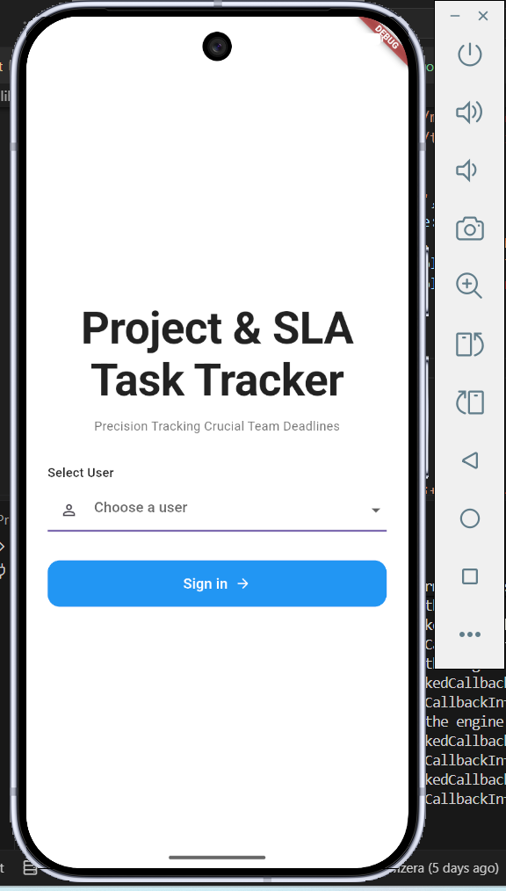
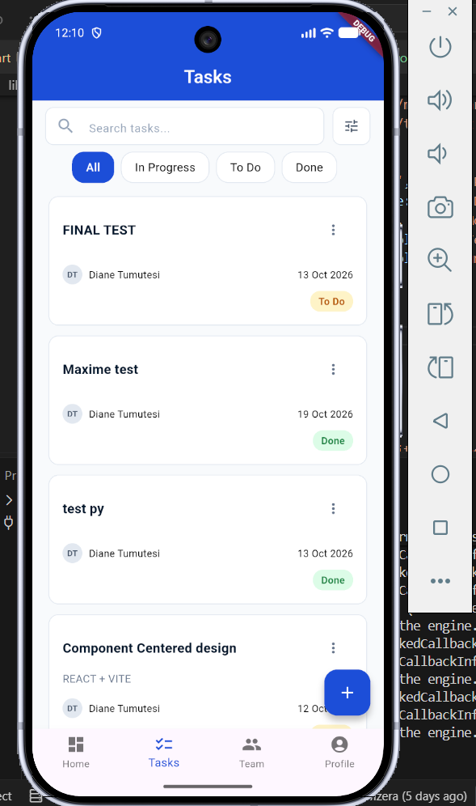
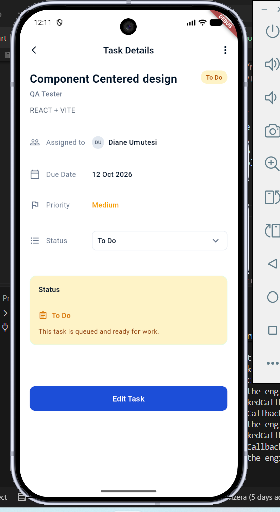
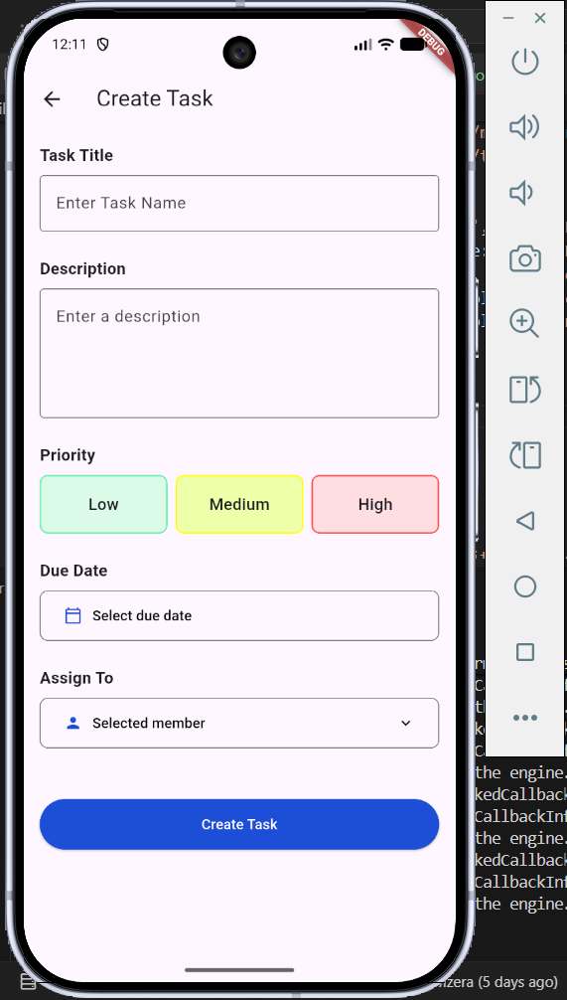
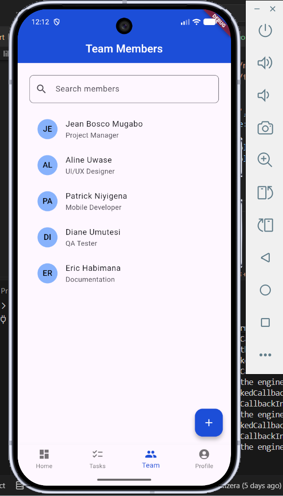
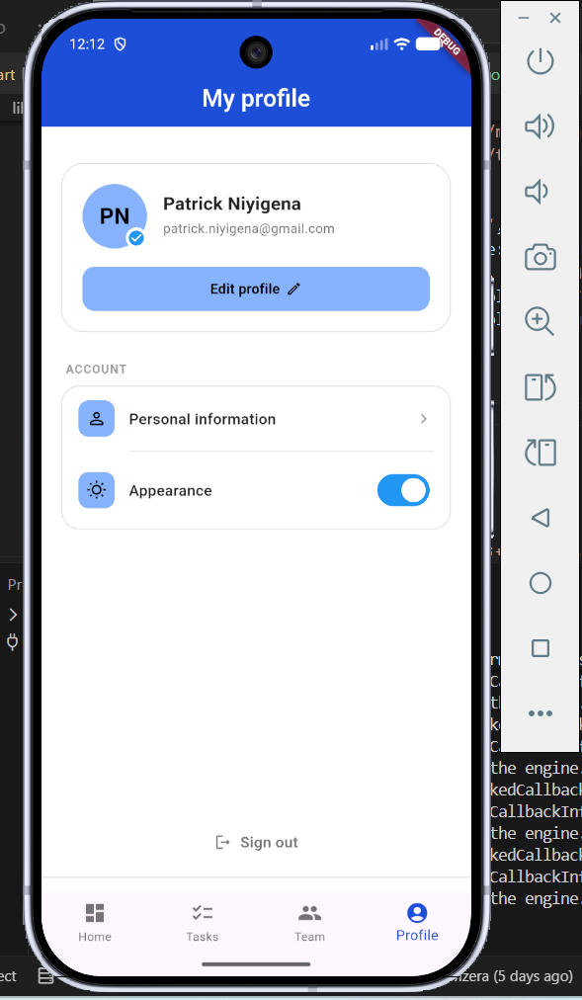

# Project & SLA Task Tracker
A Flutter application for managing project tasks, with automatic
SLA status (onTrack, atRisk, overDue, completed) based on deadlines

## Deliverables 
- [Reflection Report](https://docs.google.com/document/d/16SZXBM99MzKARVSuohF_9bIPcBNLQqzOBVJDEWjUG_w/edit?usp=sharing)
- [Team Task Sheet](https://docs.google.com/spreadsheets/d/1MGXyNmeX4GmhsNvwtdMXV8QuFGlQ-bH6koIeEV8DCEs/edit?usp=sharing) 
- [Demo Video](https://youtu.be/82uSQuYgyIg)

## Flutter Screens
<p align="center">
  
  
  
  
  
  
  
</p>
  
## Features 
- Create and edit tasks with titles and descriptions
- Assign tasks to team members, set priority and deadline
- Update task status
- Automatic task updates
- Dashboard and progress overview
- Data saved locally and kept after closing the app

## Tech Stack
- Flutter
- Dart
- sqlite local storage

## Prerequisites
- Flutter SDK
- Dart SDK
- Android Studio or Visual Studio Code
- An Android emulator or physical device
---

## Getting Started
### 1. Clone the Repository
```
    git clone https://github.com/L-nsamba/Group13_Formative_Assignment1.git
```

### 2. Navigate to the project directory
```
    cd Group13_Formative_Assignment1\project_task_tracker
```
### 3. Install project dependencies
```
    flutter pub get
```

### 4. Run the application
```
    flutter run
```
## Project Structure
```
project_task_tracker/  
  └── lib/                     
      ├── main.dart  # Logic centralization
      ├── themes/    # Colors, app theme
      ├── models/    # task & member models
      ├── utils/     # form validation
      ├── services/  # storage, SLA helper, seed data
      ├── widgets/   # widget extraction for code readability
      └── screens/   # UI screens

```

## Team and Contributions
| Member | Screens | Branch |
|---|---|---|
| Leon Nsamba | Create Task & Team Members | `leon_branch` |
| Natinael Borana | Task List & Task Details | `task_list_and_edit_task` |
| Michaella Kamikazi | Sign In & User Profile | `michaella_branch-` |
| Maxime Kwizera | Dashboard & Task Progress | `maxime_branch-` |


